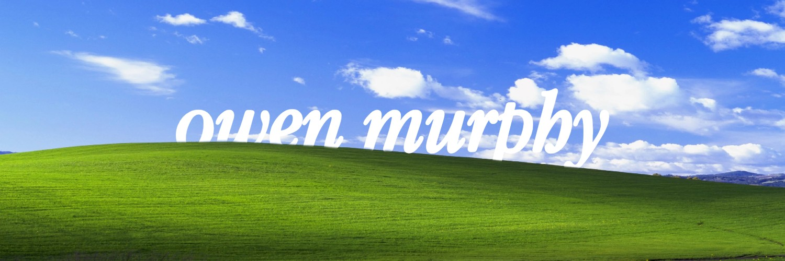

    
  
I'm Owen, a filmmaker and agentic engineer based in NJ. I started coding years ago, but have largely pivoted to [video](https://youtube.com/@odawgmurph) and [live](https://2026.owenmurphy.xyz) work. I still do some projects on the side, though:  
- [Masthead](https://masthead.news) - end-to-end school publication software (Want Masthead for your school? Email me @ [owen@masthead.news](mailto:owen@masthead.news)
- [Games Unlimited](https://github.com/odawgmurph/gamesunlimited) - Live lobby-based game clones on the web. Want to see a new game? List an issue or a PR!
- [NewVoice](https://github.com/odawgmurph/newvoice) - Duolingo but for voice training

<!--
**odawgmurph/odawgmurph** is a ✨ _special_ ✨ repository because its `README.md` (this file) appears on your GitHub profile.

Here are some ideas to get you started:

- 🔭 I’m currently working on ...
- 🌱 I’m currently learning ...
- 👯 I’m looking to collaborate on ...
- 🤔 I’m looking for help with ...
- 💬 Ask me about ...
- 📫 How to reach me: ...
- 😄 Pronouns: ...
- ⚡ Fun fact: ...
-->
